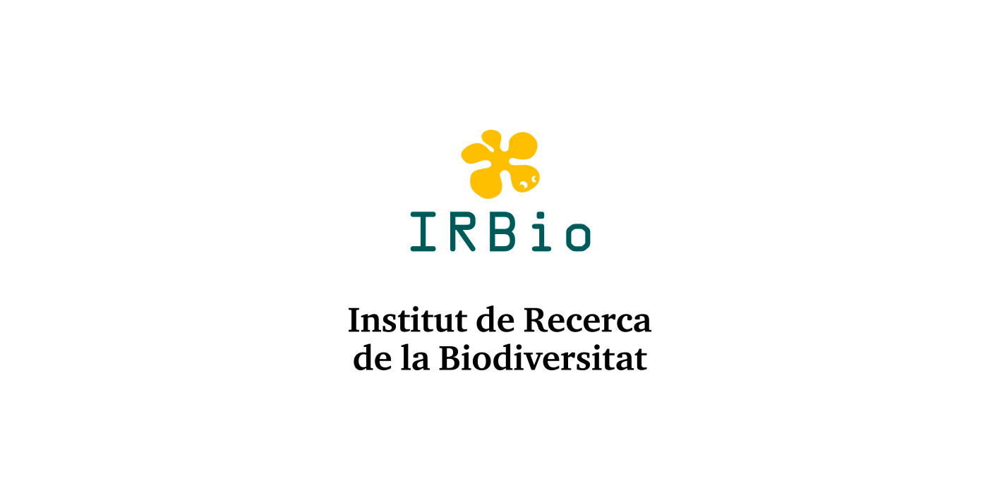
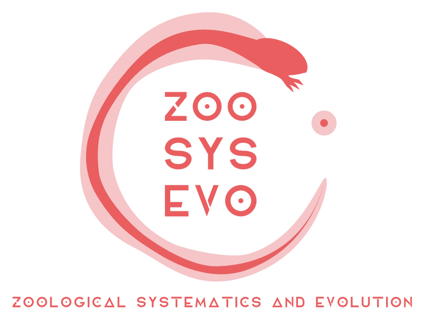
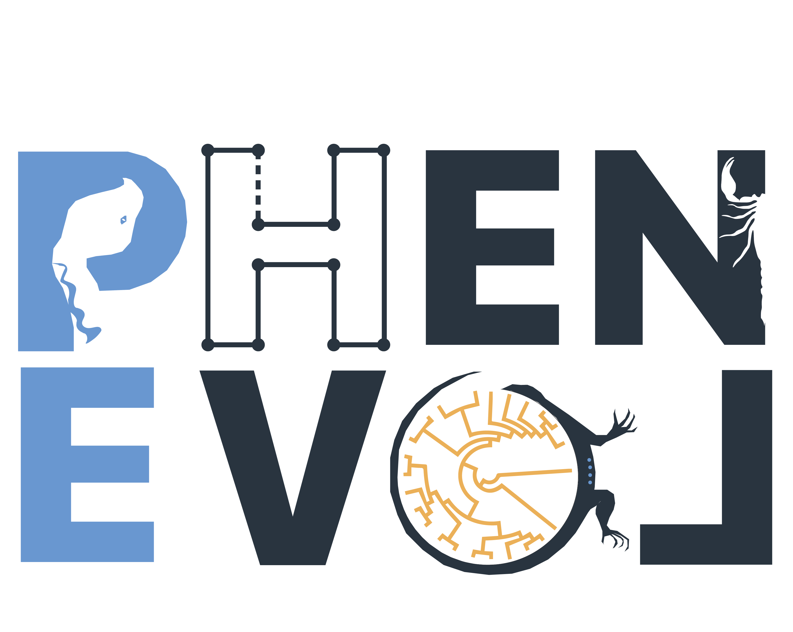

<!--
Barcelona 2027 advertisement source. Edit the page content below.
The custom HTML template preserves the full-width design without the regular
workshop navigation or Bootstrap styling. Styling lives in barcelona-2027/style.css.

In RStudio, Knit generates barcelona-2027.html. Alternatively, from R:
rmarkdown::render("Barcelona.Rmd", output_file = "barcelona-2027.html")

After knitting, copy barcelona-2027.html to index.html to show the advertisement.
The original workshop homepage remains in materials.html; index.Rmd is unchanged.
The QR code is a static asset: changing the application URL also requires a new QR.
-->

```{=html}
<a class="skip-link" href="#main">Skip to content</a>
  <header class="site-header wrap">
    <a class="wordmark" href="barcelona-2027.html" aria-label="Geometric Morphometrics workshop home"><span class="brand-mark" aria-hidden="true">GM</span><span>GEOMETRIC MORPHOMETRICS<br><small>INTERNATIONAL WORKSHOPS</small></span></a>
    <a class="materials-link" href="materials.html">Workshop materials <span aria-hidden="true">↗</span></a>
  </header>
  <main id="main">
    <section class="hero" aria-labelledby="course-title">
      <div class="wrap hero-inner">
        <p class="eyebrow">BARCELONA, SPAIN <span aria-hidden="true">/</span> JUNE 14–18, 2027</p>
        <h1 id="course-title">Geometric<br>Morphometrics <em>using R</em></h1>
        <p class="hero-subtitle">Museu de Ciències Naturals de Barcelona</p>
        <p class="fee-note">NO registration fee</p>
        <p class="hero-description">Five days of theory and hands-on analysis of biological shape, with Dean Adams and Michael Collyer.</p>
        <div class="hero-actions"><a class="button button-yellow" href="#apply">Apply for the workshop <span aria-hidden="true">↗</span></a><a class="hero-anchor" href="#about">Explore the course <span aria-hidden="true">↓</span></a></div>
        <p class="deadline">Apply by December 15 for full consideration</p>
        <div class="hero-footer"><span>14–18 <strong>JUNE 2027</strong></span><span>Barcelona <strong>SPAIN</strong></span><span>Lectures + practical sessions <strong>GEOMORPH IN R</strong></span></div>
      </div>
      <svg class="shape-art" viewBox="0 0 500 540" fill="none" aria-hidden="true">
        <g stroke="currentColor" stroke-width="1.3"><path d="M85 210 180 95 345 120 425 265 345 430 180 405 85 210 345 120 345 430 180 95 180 405 425 265 85 210M180 95 425 265M180 405 345 120"/><path d="M55 225 160 55 365 95 465 280 355 470 145 435 55 225 365 95 355 470 160 55 145 435 465 280 55 225" stroke-dasharray="5 8" opacity=".55"/></g>
        <g fill="#f1de69"><circle cx="85" cy="210" r="6"/><circle cx="180" cy="95" r="6"/><circle cx="345" cy="120" r="6"/><circle cx="425" cy="265" r="6"/><circle cx="345" cy="430" r="6"/><circle cx="180" cy="405" r="6"/></g>
        <g fill="currentColor"><circle cx="55" cy="225" r="4"/><circle cx="160" cy="55" r="4"/><circle cx="365" cy="95" r="4"/><circle cx="465" cy="280" r="4"/><circle cx="355" cy="470" r="4"/><circle cx="145" cy="435" r="4"/></g>
      </svg>
    </section>
    <section class="about wrap section" id="about" aria-labelledby="about-title">
      <div><p class="eyebrow teal">THE WORKSHOP</p><h2 id="about-title">From landmark data<br>to biological insight.</h2></div>
      <div class="about-copy"><p>Explore how geometric morphometrics quantifies shape variation and connects it to questions in ecology and evolutionary biology.</p><p>Combine a grounding in theory with practical sessions in R using <strong>geomorph</strong>. Work through data collection, statistical analysis, and the visualization and interpretation of shape variation.</p><p><a class="course-details" href="materials.html">More course details here <span aria-hidden="true">→</span></a></p><p class="prerequisite"><strong>Before you join:</strong> A working knowledge of R is recommended. Practice datasets are provided; participants are encouraged to bring their own data.</p></div>
    </section>
    <section class="instructors-section" aria-labelledby="instructors-title"><div class="wrap section">
      <div class="section-heading"><div><p class="eyebrow teal">MEET YOUR INSTRUCTORS</p><h2 id="instructors-title">Learn with Dean &amp; Mike.</h2></div><p>The primary authors and maintainers<br>of <strong>geomorph</strong> and <strong>RRPP</strong>.</p></div>
      <div class="instructors">
        <article class="instructor"><a class="portrait-link" href="https://dean-adams.org"></a><div><p class="instructor-label">DISTINGUISHED PROFESSOR</p><h3><a href="https://dean-adams.org">Dean C. Adams</a></h3><p>Iowa State University</p></div></article>
        <article class="instructor"><a class="portrait-link" href="https://michaelcollyer.com"></a><div><p class="instructor-label">PROFESSOR</p><h3><a href="https://michaelcollyer.com">Michael Collyer</a></h3><p>Chatham University</p></div></article>
      </div>
    </div></section>
    <section class="apply-section" id="apply" aria-labelledby="apply-title"><div class="wrap apply-inner">
      <div class="apply-copy"><p class="eyebrow">JOIN US IN BARCELONA</p><h2 id="apply-title">Your next perspective<br>on shape starts here.</h2><p>June 14–18, 2027 · Barcelona, Spain<br>Museu de Ciències Naturals de Barcelona<br><strong class="free-text">NO registration fee</strong></p><p class="application-deadline">Apply by December 15 for full consideration</p><p>Open the application form, or scan the QR code<br class="desktop-break"> to continue on your phone.</p><a class="button button-yellow" href="https://docs.google.com/forms/d/e/1FAIpQLSdwQ-jnskJB8pqpy3Jv5YXh0OHVBbmyyMzO0Qt_bGE73qPk1w/viewform?usp=sharing&amp;ouid=102214816417069495319">Open application form <span aria-hidden="true">↗</span></a></div>
      <figure class="qr-card"><a href="https://docs.google.com/forms/d/e/1FAIpQLSdwQ-jnskJB8pqpy3Jv5YXh0OHVBbmyyMzO0Qt_bGE73qPk1w/viewform?usp=sharing&amp;ouid=102214816417069495319" aria-label="Open the workshop application form"></a><figcaption>SCAN TO APPLY <span aria-hidden="true">↗</span></figcaption></figure>
    </div></section>
    <aside class="materials-banner wrap"><div><h2>Already taking a workshop?</h2><p>Find lectures, lab tutorials, schedules, and references.</p></div><a class="button button-outline" href="materials.html">Go to workshop materials <span aria-hidden="true">→</span></a></aside>
    <section class="sponsors wrap" aria-labelledby="sponsors-title"><p class="eyebrow teal" id="sponsors-title">IN COLLABORATION WITH</p><div class="sponsor-logos"></div></section>
  </main>
  <footer class="site-footer wrap"><span>Geometric Morphometrics using R</span><span>Barcelona · June 14–18, 2027</span></footer>
```
